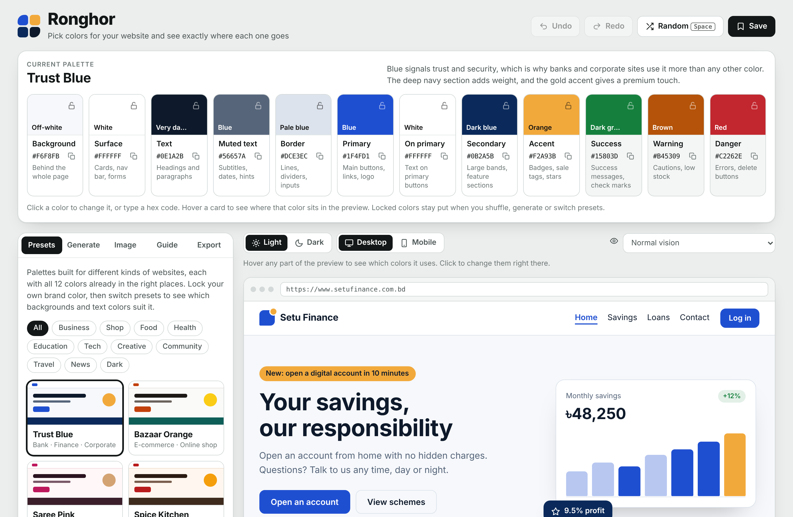

# Ronghor Color Studio

**Pick website colors and see exactly where each one goes.**

Ronghor (রঙঘর, Bengali for "house of color") is a color palette tool built for websites rather than for color theory. Every palette has 12 named roles (background, text, primary button, badge, error, and so on), and a live sample website shows each color in its real place as you edit. It checks readability with WCAG contrast rules and exports ready-to-use CSS or Tailwind code.

Plain HTML, CSS and JavaScript modules. No build step, no framework, no dependencies and no tracking.



## Features

- **17 presets by website type**: bank, e-commerce, fashion, restaurant, café, clinic, education, kids, SaaS, developer (dark), gaming (dark), portfolio, NGO, government, travel, real estate and news. Each preset explains why its colors work together, and the sample site's text changes to match the type of website.
- **12 color roles**: Background, Surface, Text, Muted text, Border, Primary, On primary, Secondary, Accent, Success, Warning and Danger. Each role card says where the color is used.
- **Live sample website**: hover any role card to outline where that color appears, hover the preview to see which colors an element uses, and click an element to change its colors in place.
- **Contrast check**: 12 text and background pairs measured against WCAG 2 (4.5:1 for text, 3:1 for icons, 7:1 for AAA). Any failing pair has a one-click fix that adjusts the color's lightness until it passes.
- **Locks**: lock your brand color, then switch presets, generate or shuffle to find neutrals and accents that suit it.
- **Generator**: drag on a color wheel or enter a hex code, then pick a harmony (monochrome, analogous, complementary, split, triadic) and a mood (soft, vivid, dark).
- **Colors from an image**: upload a logo or photo to pull out its main colors and build a palette from them.
- **Light and dark**: every palette gets an automatically derived opposite mode, which you can preview and export.
- **Color vision simulation**: preview the site as seen with protanopia, deuteranopia, tritanopia or in greyscale.
- **Desktop and mobile preview**: the sample site uses container queries, so the mobile view is a real mobile layout.
- **Export**: CSS custom properties, SCSS variables, Tailwind v4 `@theme`, Tailwind v3 config, or JSON. Optional dark mode values and 50 to 950 shade scales for the primary, secondary and accent colors.
- **Guide**: the 60-30-10 rule shown with your colors, what your primary hue communicates, and eight rules for a good palette.
- **Undo, redo and saved palettes**, kept in your browser's local storage.

## Getting started

The JavaScript uses ES modules, which browsers don't load from `file://`. Run any static server from the project folder:

```bash
git clone https://github.com/<your-username>/ronghor.git
cd ronghor
npx serve .                 # or: python -m http.server 8000
```

Then open the address it prints (for example `http://localhost:3000` or `http://localhost:8000`).

### Host it on GitHub Pages

1. Push the repository to GitHub.
2. Go to **Settings → Pages**.
3. Under **Build and deployment**, choose **Deploy from a branch**, select `main` and `/ (root)`, then save.
4. After a minute the tool is live at `https://<your-username>.github.io/ronghor/`.

## Project structure

```
ronghor/
├── index.html                 Markup only; loads the CSS files and js/main.js
├── css/
│   ├── tokens.css             Tool colors, fonts, light and dark themes
│   ├── base.css               Reset and utilities
│   ├── layout.css             Main grid, side panel, tabs
│   ├── responsive.css         Breakpoints and reduced motion
│   └── components/            One file per part of the UI
│       ├── header.css   rail.css     presets.css  generator.css
│       ├── image.css    guide.css    export.css   stage.css
│       └── preview.css  contrast.css toast.css
└── js/
    ├── main.js                Startup, keyboard shortcuts
    ├── dom.js                 $ and $$ helpers
    ├── state.js               App state, saving to local storage
    ├── history.js             Undo and redo
    ├── actions.js             Apply preset, generate, random, fix, save
    ├── render.js              Redraws everything from state
    ├── color/
    │   ├── math.js            Hex/HSL conversion, WCAG contrast, mixing
    │   ├── oklch.js           OKLab/OKLCH and shade scales
    │   ├── palette.js         Generator and light/dark derivation
    │   ├── names.js           Color names and color meanings
    │   └── extract.js         Colors from an image
    ├── data/
    │   ├── roles.js           The 12 color roles
    │   ├── presets.js         Palette presets and categories
    │   ├── content.js         Sample website text for each site type
    │   ├── harmonies.js       Color harmony rules
    │   ├── pairs.js           Contrast pairs that get checked
    │   └── tips.js            Palette rules shown in the guide
    └── components/
        ├── strip.js     header.js    preview.js   contrast.js
        ├── generator.js guide.js     export.js    presets.js
        └── controls.js  image.js     icons.js     toast.js
```

The sample website's text lives in `js/data/content.js`. Each preset's `content` field picks which entry is shown, and the page template is `siteHTML()` in `js/components/preview.js`.

## Keyboard shortcuts

| Key | Action |
| --- | --- |
| `Space` | New random palette (locked colors stay) |
| `Ctrl` / `Cmd` + `Z` | Undo |
| `Ctrl` / `Cmd` + `Shift` + `Z`, or `Ctrl` + `Y` | Redo |
| `Enter` in a hex field | Apply the hex code |
| `←` `→` on the color wheel | Rotate the base hue |
| `←` `→` on the tabs | Switch tabs |
| `Esc` | Close the color popover |

## The 12 color roles

| Role | CSS variable | Where it goes |
| --- | --- | --- |
| Background | `--color-bg` | Behind the whole page |
| Surface | `--color-surface` | Cards, nav bar, forms |
| Text | `--color-text` | Headings and paragraphs |
| Muted text | `--color-muted` | Subtitles, dates, hints |
| Border | `--color-border` | Lines, dividers, inputs |
| Primary | `--color-primary` | Main buttons, links, logo |
| On primary | `--color-on-primary` | Text on primary buttons |
| Secondary | `--color-secondary` | Large bands, feature sections |
| Accent | `--color-accent` | Badges, sale tags, stars |
| Success | `--color-success` | Success messages, check marks |
| Warning | `--color-warning` | Cautions, low stock |
| Danger | `--color-danger` | Errors, delete buttons |

Exports also include `--color-on-secondary` and `--color-on-accent`, which are picked automatically (white or the palette's darkest color, whichever reads better).

## How it works

- **Contrast** uses the WCAG 2 relative luminance formula.
- **Fixes and generated colors** step a color's HSL lightness until the required contrast is reached, so the hue stays the same.
- **Shade scales** are built in OKLCH, with fixed lightness steps and chroma tapered toward the ends, then mapped back into the sRGB gamut.
- **Dark and light versions** are derived from the base palette: neutrals are rebuilt from the background's hue, and brand and status colors are lightened or darkened only as much as contrast requires.
- **Image colors** are found by bucketing pixels and merging similar colors in OKLab space.
- **Color vision simulation** uses standard SVG color matrices. It is an approximation, useful for spotting problems, not a medical model.

## Adding a preset

Presets live in the `PRESETS` array in `js/data/presets.js`. Add an object like this:

```js
{
  id: 'my-preset',
  name: 'My Preset',
  cat: 'business',            // business, shop, food, health, edu, tech, creative, social, travel, media
  content: 'corporate',       // which sample site text to show (see js/data/content.js)
  tags: 'Agency · Consulting',
  why: 'One or two sentences on why these colors work together.',
  c: {
    bg: '#F6F8FB', surface: '#FFFFFF', text: '#0E1A2B', muted: '#56657A', border: '#DCE3EC',
    primary: '#1F4FD1', onPrimary: '#FFFFFF', secondary: '#0B2A5B', accent: '#F2A93B',
    success: '#15803D', warning: '#B45309', danger: '#C2262E'
  }
}
```

Open the page, pick your preset and make sure the contrast check shows 12/12 before submitting it.

## Browser support

Current versions of Chrome, Edge, Firefox and Safari. The page uses CSS container queries, `color-mix()` and the native color input. Fonts (Bricolage Grotesque, Figtree, JetBrains Mono) load from Google Fonts; without a connection the page falls back to system fonts and still works.

## Contributing

Issues and pull requests are welcome, especially new presets, sample site content for other kinds of websites, and translations.

## License

[MIT](LICENSE)
